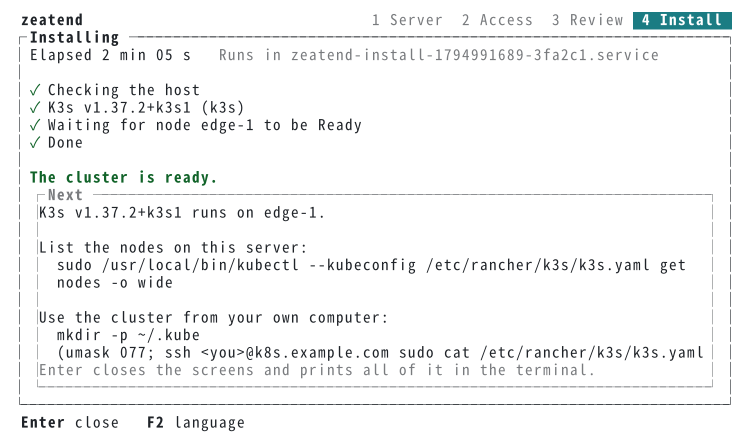
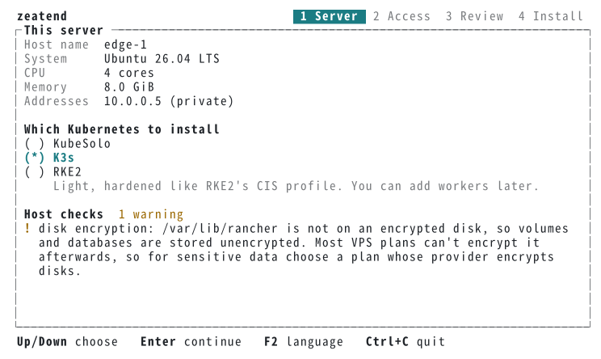

<picture>
  <source media="(prefers-color-scheme: dark)" srcset="docs/images/cover-dark.avif">
  
</picture>

English | [繁體中文](README.zh-TW.md) | [简体中文](README.zh-CN.md)

# Zeabur Zeatend

A Kubernetes cluster manager in the spirit of [k3sup](https://github.com/alexellis/k3sup). It
sets up and manages K3s, RKE2 and KubeSolo clusters on hosts over SSH, with a terminal UI.

Zeatend is made by the Zeabur project and is in early development.

## Install

### What you need

- A Linux host that boots with systemd, on x86-64 (amd64) or ARM64 (arm64). K3s, RKE2 and KubeSolo
  run as systemd services, so `zeatend apply` does not start an install on a host without systemd.
- Root through `sudo`.
- Memory: at least 1900 MiB for K3s, which a 2 GiB host has, and 1400 MiB for KubeSolo. RKE2 needs
  more. The host checks warn when the memory is too low.
- Disk: at least 10 GiB free on the file system that holds the cluster's data, and 30 GiB or more
  to be comfortable.
- Network: the host reaches GitHub to download K3s, RKE2 or KubeSolo.
- The ports Kubernetes needs are free. A KubeSolo host must not have Docker.

The host checks also look at whether the clock is synchronised, whether swap is off, and whether an
earlier Kubernetes install left files on the host.

### Download zeatend

Run these commands on the host. The first line gets the latest version, such as `v0.1.0`, from
[GitHub Releases](https://github.com/zeabur-oss/zeatend/releases); to install another version,
replace the first line with `version=v0.1.0` or the version you want.

```sh
version=$(basename "$(curl -fsSLo /dev/null -w '%{url_effective}' https://github.com/zeabur-oss/zeatend/releases/latest)")
arch=$(uname -m | sed 's/x86_64/amd64/; s/aarch64/arm64/')
curl -fsSLO "https://github.com/zeabur-oss/zeatend/releases/download/$version/zeatend-$version-linux-$arch.tar.gz" &&
  curl -fsSLO "https://github.com/zeabur-oss/zeatend/releases/download/$version/SHA256SUMS" &&
  sha256sum --ignore-missing -c SHA256SUMS &&
  tar -xzf "zeatend-$version-linux-$arch.tar.gz" zeatend &&
  sudo install -m 0755 zeatend /usr/local/bin/zeatend &&
  zeatend --version
```

`sha256sum` prints `OK` when the download matches the release. `zeatend` is a static executable
and needs no other packages.

### Install the cluster

Use the install screens or the commands:

- Run `sudo zeatend`. The screens ask for the distribution, the address and the node name, show
  the install plan, and start the install when you confirm it.
- Run `sudo zeatend plan` to see what it installs and the host checks, then `sudo zeatend apply`
  to install. Without `/etc/zeatend/config.yaml`, zeatend installs K3s with the defaults; for RKE2
  or KubeSolo, write the configuration file first, as "Usage" below shows.

```sh
sudo zeatend plan
sudo zeatend apply
```

`plan` changes nothing on the host. When a host check fails, `apply` does not start the install;
fix what the message names and run it again.

### When it worked

When the install is done, the install screen says "The cluster is ready." and shows the commands
to go on with:



When `zeatend apply` ends, it prints the release, the node and the commands to go on with. On
K3s:

```text
==> Waiting for node vps-1 to be Ready
==> Done
K3s v1.37.2+k3s1 runs on vps-1.

List the nodes on this server:
  sudo /var/lib/rancher/k3s/data/current/bin/kubectl --kubeconfig /etc/rancher/k3s/k3s.yaml get nodes -o wide
```

Then it prints the commands that copy the kubeconfig to your own computer. Later,
`sudo zeatend doctor` checks the host and the cluster at any time; each line that is not `ok`
names the command to run.

## Usage

Today `zeatend` runs on the Linux host it installs, as root. `sudo zeatend` with no command opens
the install screens in English, 繁體中文 or 简体中文:



They show the host and its checks, ask for the distribution, the address and DNS name of the API
server and the node name, and show the plan. The choices go into `/etc/zeatend/config.yaml`, and
the install runs as with `zeatend apply`. Every screen, at 80x24 and 120x36, is in
[docs/screens](docs/screens). The language comes from the locale, as for the host checks, and F2
changes it. A terminal that cannot show Chinese, such as the Linux console, gets English with
ASCII borders.

Without the screens, `zeatend` reads one configuration file,
`/etc/zeatend/config.yaml` by default, and installs K3s, RKE2 or KubeSolo hardened to the CIS
benchmark:

```yaml
distribution: k3s # k3s (default), rke2 or kubesolo
host:
  tlsSan: [k8s.example.com]
```

K3s (`v1.37.2+k3s1`) and RKE2 (`v1.37.2+rke2r1`) install Kubernetes 1.37. KubeSolo `v1.3.0` installs
Kubernetes 1.36.6, because KubeSolo has no 1.37 release yet.

K3s and RKE2 deploy their packaged components as upstream ships them, Traefik among them. To run
your own instead, turn them off with `disable`, such as `disable: [traefik, metrics-server]`.
`local-storage` turns off K3s's local-path storage class. KubeSolo packages none of these. On a
cluster that zeabur-installer installed, `disable` starts as the list the installer turned off.

- `zeatend plan` shows what `apply` would install and runs the host checks; `--json` prints the
  plan as JSON.
- `zeatend apply` installs, or brings an install in line with the configuration. It is safe to
  run again. `apply --plan <file>` applies the plan that `plan --json` wrote to the file, and
  changes nothing when a file it writes, the installed release or the install record changed
  since.
- `zeatend uninstall` removes K3s, RKE2 or KubeSolo and the files zeatend wrote. It shows what it
  removes and keeps, and asks first (`--yes` skips the question). Volumes stay unless you add
  `--delete-volumes`.

On a host with systemd, `apply` runs the install in the transient unit
`zeatend-install-<id>.service` and shows its progress. When the SSH session ends, the install goes
on. Run `sudo zeatend apply` again to follow it: while an install unit runs, `apply` shows that
unit's progress from the journal and starts nothing new. `journalctl -u 'zeatend-install-*'` has the
full output. `apply --foreground` runs the install in the same process instead, and `apply --json`
prints the progress as JSON lines.

A configuration with a `join` section joins this host to an existing K3s or RKE2 cluster:

```yaml
distribution: k3s
join:
  server: https://10.0.0.5:6443 # port 9345 on RKE2
  role: worker # or server, on RKE2 only
  tokenFile: /etc/zeatend/join-token # mode 0600
```

## Contributing

See [CONTRIBUTING.md](CONTRIBUTING.md). Report security issues as described in
[SECURITY.md](SECURITY.md).

## License

[Apache-2.0](LICENSE).
