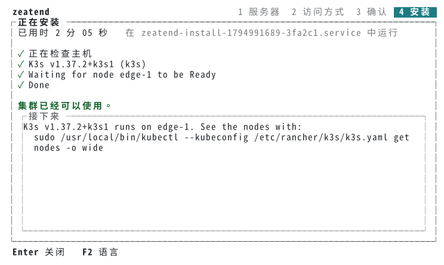
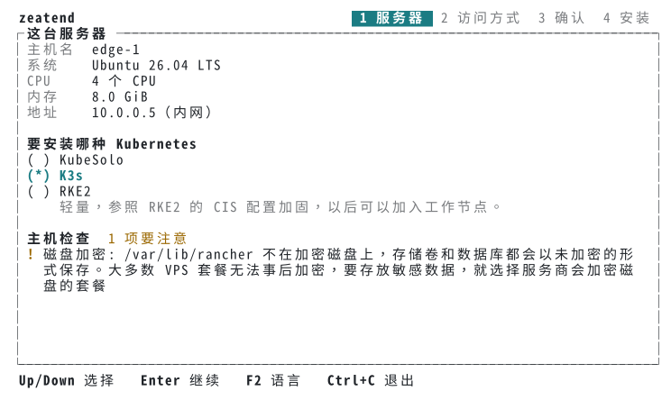

<picture>
  <source media="(prefers-color-scheme: dark)" srcset="docs/images/cover-zh-CN-dark.avif">
  
</picture>

<!-- The names of the languages, each in its own script. -->
<!-- vale ZeaburZhCN.Script = NO -->
[English](README.md) | [繁體中文](README.zh-TW.md) | 简体中文
<!-- vale ZeaburZhCN.Script = YES -->

# Zeatend

Zeatend 是管理 Kubernetes 集群的工具，思路和 [k3sup](https://github.com/alexellis/k3sup) 相近。它通过 SSH 在主机上安装和管理 K3s、RKE2 和 KubeSolo 集群，并提供终端界面。

Zeatend 属于 Zeabur 的开源项目，目前还处在早期开发阶段。

## 安装

### 需要的主机

- 一台用 systemd 启动的 Linux 主机，处理器为 x86-64（amd64）或 ARM64（arm64）。K3s、RKE2 和 KubeSolo 都作为 systemd 服务运行，所以主机没有 systemd 时，`zeatend apply` 不会开始安装。
- 能用 `sudo` 获得 root 权限。
- 内存：K3s 至少 1900 MiB，2 GiB 的主机就够；KubeSolo 至少 1400 MiB；RKE2 需要更多。内存不够时，主机检查会给出提醒。
- 磁盘：集群数据所在的文件系统至少要有 10 GiB 可用空间，建议 30 GiB 以上。
- 网络：主机要能访问 GitHub，下载 K3s、RKE2 或 KubeSolo。
- Kubernetes 需要的端口没有被占用。KubeSolo 的主机上不能有 Docker。

主机检查还会看时间是否同步、swap 是否关闭，以及之前安装的 Kubernetes 有没有留下文件。

### 下载 zeatend

在主机上运行下面的命令。第一行从 [GitHub Releases](https://github.com/zeabur-oss/zeatend/releases) 获取最新版本，例如 `v0.1.0`；要装其他版本，把第一行换成 `version=v0.1.0` 这样的版本号。

```sh
version=$(basename "$(curl -fsSLo /dev/null -w '%{url_effective}' https://github.com/zeabur-oss/zeatend/releases/latest)")
arch=$(uname -m | sed 's/x86_64/amd64/; s/aarch64/arm64/')
curl -fsSLO "https://github.com/zeabur-oss/zeatend/releases/download/$version/zeatend-$version-linux-$arch.tar.gz" &&
  curl -fsSLO "https://github.com/zeabur-oss/zeatend/releases/download/$version/SHA256SUMS" &&
  sha256sum --ignore-missing -c SHA256SUMS &&
  tar -xzf "zeatend-$version-linux-$arch.tar.gz" zeatend &&
  sudo install -m 0755 zeatend /usr/local/bin/zeatend &&
  zeatend --version
```

`sha256sum` 输出 `OK`，说明下载的文件和 release 一致。`zeatend` 是静态可执行文件，不需要再安装其他软件包。

### 安装集群

用安装界面或命令，二选一：

- 运行 `sudo zeatend`，按界面选择发行版，填写地址和节点名称，确认安装计划后开始安装。
- 先运行 `sudo zeatend plan` 查看要安装的内容和主机检查，再运行 `sudo zeatend apply` 安装。没有 `/etc/zeatend/config.yaml` 时，zeatend 会用默认值安装 K3s；要改用 RKE2 或 KubeSolo，先写好配置文件，写法见下面的“使用方法”。

```sh
sudo zeatend plan
sudo zeatend apply
```

`plan` 不会改动主机。主机检查没有通过时，`apply` 不会开始安装，请先按提示修正，再运行一次。

### 安装成功时

安装完成时，安装界面会显示“集群已经可以使用”，下方是接下来可以运行的命令：



`zeatend apply` 结束时，会输出版本、节点和接下来的命令。K3s 的输出类似这样：

```text
==> 等待节点 vps-1 就绪
==> 完成
K3s v1.37.2+k3s1 已经在 vps-1 上运行。

在这台服务器上列出节点：
  sudo /var/lib/rancher/k3s/data/current/bin/kubectl --kubeconfig /etc/rancher/k3s/k3s.yaml get nodes -o wide
```

终端接着会输出把 kubeconfig 复制到你电脑上的命令。之后随时可以运行 `sudo zeatend doctor` 检查主机和集群；有项目没通过时，那一行会写出该运行的命令。

## 使用方法

目前 `zeatend` 需要以 root 身份，在它要安装的那台 Linux 主机上运行。不带命令运行 `sudo zeatend`，会打开安装界面，可以选择英文、繁体中文或简体中文：



界面会显示主机信息和检查结果，让你选择发行版，填写 API 服务器的地址、DNS 名称和节点名称，最后显示安装计划。你的选择会写入 `/etc/zeatend/config.yaml`，安装过程和 `zeatend apply` 一样。所有界面在 80x24 和 120x36 下的样子都在 [docs/screens](docs/screens)。语言和主机检查一样取自区域设置，按 F2 可以切换。Linux 控制台这类不能显示中文的终端，会改用英文和 ASCII 边框。

不打开界面时，`zeatend` 读取一个配置文件（默认是 `/etc/zeatend/config.yaml`），安装按 CIS 基准加固的 K3s、RKE2 或 KubeSolo：

```yaml
distribution: k3s # k3s（默认）、rke2 或 kubesolo
host:
  tlsSan: [k8s.example.com]
```

K3s（`v1.37.2+k3s1`）和 RKE2（`v1.37.2+rke2r1`）安装 Kubernetes 1.37。KubeSolo 还没有 1.37 版，所以 KubeSolo `v1.3.1` 安装的是 Kubernetes 1.36.6。

K3s 和 RKE2 按上游的默认设置，部署自带的组件，例如 Traefik。要改用自己安装的版本，就用 `disable` 关闭，例如 `disable: [traefik, metrics-server]`。`local-storage` 会关闭 K3s 的 local-path 存储类。KubeSolo 没有这些组件。

KubeSolo 内置的 bridge 网络不执行网络策略（见 [KubeSolo 的 CNI 说明](https://github.com/portainer/kubesolo/blob/v1.3.0/docs/configuration/cni.md)），所以 Zeabur 开源版在 KubeSolo 上无法隔离项目：每个项目的服务都能连接其他项目。项目之间需要隔离时，请安装 K3s 或 RKE2。

`storage: {longhorn: true}` 会为主机准备好 Longhorn 需要的环境，Zeabur Catalog 会在多节点集群上安装 Longhorn：`apply` 用 apt 或 dnf 安装 iSCSI initiator 和 NFS 客户端，设置开机时加载 `iscsi_tcp` 和 `dm_crypt`，启动 `iscsid`，并让 multipathd 避开 Longhorn 的磁盘。节点缺少其中任何一项时，`zeatend doctor` 会报告；`zeatend node add` 会让新节点沿用同样的设置。

`apiServer.authenticationConfig` 是 API 服务器的[认证配置](https://kubernetes.io/docs/reference/access-authn-authz/authentication/#using-authentication-configuration)，按 Kubernetes 文档的格式写，例如让 API 服务器接受某个 OpenID Connect 签发者的令牌：

```yaml
apiServer:
  authenticationConfig:
    apiVersion: apiserver.config.k8s.io/v1
    kind: AuthenticationConfiguration
    jwt:
      - issuer:
          url: https://identity.example.com
          audiences: [kubernetes]
        claimMappings:
          username: {claim: preferred_username, prefix: "zeabur:"}
          groups: {claim: groups, prefix: "zeabur:"}
```

在服务器节点上，zeatend 会把它写成文件交给 API 服务器。字段由 Kubernetes 在 API 服务器启动或重新读取文件时检查。在 K3s 和 RKE2 上，如果配置中没有 `anonymous`，zeatend 会加上 `anonymous: {enabled: false}`，匿名请求就保持关闭。修改配置后，下一次 `apply` 就会生效。

- `zeatend plan` 显示 `apply` 会安装哪些内容，并运行主机检查；加上 `--json` 会以 JSON 输出计划。
- `zeatend apply` 负责安装，或让现有的安装与配置文件一致。重复运行也没有问题。`apply --plan <文件>` 会应用 `plan --json` 写入文件的计划；如果计划要写入的文件、安装的版本或安装记录在那之后发生了变化，就不会做任何更改。
- `zeatend uninstall` 删除 K3s、RKE2 或 KubeSolo，以及 zeatend 写入的文件。它会先列出要删除和保留的内容，并询问是否继续（`--yes` 跳过询问）。除非加上 `--delete-volumes`，存储卷都会保留。

在使用 systemd 的主机上，`apply` 会在临时单元 `zeatend-install-<id>.service` 中运行安装，并显示进度。SSH 连接断开后，安装会继续。再运行一次 `sudo zeatend apply` 就能接着查看：安装单元运行期间，`apply` 会从 journal 显示该单元的进度，不会另外开始新的安装。完整输出可以用 `journalctl -u 'zeatend-install-*'` 查看。`apply --foreground` 不创建单元，直接在当前的 zeatend 进程中运行安装，`apply --json` 则以 JSON 逐行输出进度。

配置文件中有 `join` 部分时，这台主机会加入现有的 K3s 或 RKE2 集群：

```yaml
distribution: k3s
join:
  server: https://10.0.0.5:6443 # RKE2 用 9345 端口
  role: worker # RKE2 也可以设为 server
  tokenFile: /etc/zeatend/join-token # 权限 0600
```

## 参与贡献

请参阅 [CONTRIBUTING.md](CONTRIBUTING.md)。报告安全问题的方式见 [SECURITY.md](SECURITY.md)。

## 许可证

[Apache-2.0](LICENSE)。
