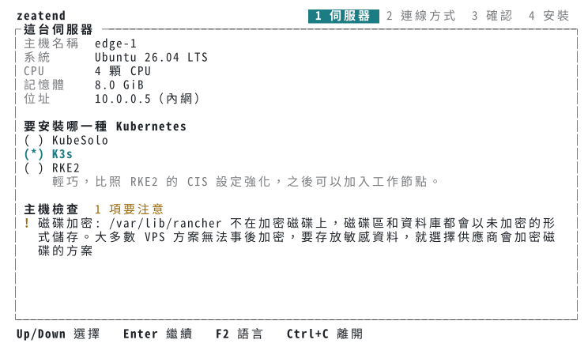

<picture>
  <source media="(prefers-color-scheme: dark)" srcset="docs/images/cover-zh-TW-dark.avif">
  
</picture>

<!-- The names of the languages, each in its own script. -->
<!-- vale ZeaburZhTW.Script = NO -->
[English](README.md) | 繁體中文 | [简体中文](README.zh-CN.md)
<!-- vale ZeaburZhTW.Script = YES -->

# Zeabur Zeatend

Zeatend 是管理 Kubernetes 叢集的工具，概念和 [k3sup](https://github.com/alexellis/k3sup) 相近。它透過 SSH 在主機上安裝並管理 K3s、RKE2 和 KubeSolo 叢集，也提供終端機介面。

Zeatend 由 Zeabur 專案開發，目前還在早期開發階段。

## 使用方式

目前 `zeatend` 要以 root 身分，在它安裝的那台 Linux 主機上執行。不加指令執行 `sudo zeatend`，會開啟安裝畫面，可以選擇英文、繁體中文或簡體中文：



畫面會顯示主機資訊和檢查結果，讓你選擇發行版，填寫 API 伺服器的位址、DNS 名稱和節點名稱，最後顯示安裝計畫。你的選擇會寫進 `/etc/zeatend/config.yaml`，安裝過程和 `zeatend apply` 相同。所有畫面在 80x24 和 120x36 下的樣子都放在 [docs/screens](docs/screens)。語言跟主機檢查一樣取自語系設定，按 F2 可以切換。Linux 主控台這類無法顯示中文的終端機，會改用英文和 ASCII 邊框。

不開啟畫面時，`zeatend` 會讀取一個設定檔（預設是 `/etc/zeatend/config.yaml`），安裝依 CIS 基準強化的 K3s、RKE2 或 KubeSolo：

```yaml
distribution: k3s # k3s（預設）、rke2 或 kubesolo
host:
  tlsSan: [k8s.example.com]
```

K3s（`v1.37.2+k3s1`）和 RKE2（`v1.37.2+rke2r1`）安裝 Kubernetes 1.37。KubeSolo 還沒有 1.37 版，所以 KubeSolo `v1.3.0` 安裝的是 Kubernetes 1.36.6。

K3s 和 RKE2 照上游的預設，部署自帶的元件，例如 Traefik。要改用自己安裝的版本，就用 `disable` 關掉，例如 `disable: [traefik, metrics-server]`。`local-storage` 會關掉 K3s 的 local-path 儲存類別。KubeSolo 沒有這些元件。由 zeabur-installer 安裝的叢集，`disable` 一開始就是 installer 關掉的那些元件。

`apiServer.jwt` 讓 API 伺服器接受 OpenID Connect 簽發者的權杖。Zeatend 會把它寫進伺服器節點上 API 伺服器的[驗證設定](https://kubernetes.io/docs/reference/access-authn-authz/authentication/#using-authentication-configuration)：

```yaml
apiServer:
  jwt:
    - issuer: https://identity.example.com
      audiences: [kubernetes]
      usernameClaim: preferred_username # 預設是 sub
      usernamePrefix: "zeabur:"
      groupsClaim: groups # 可省略，要和 groupsPrefix 一起設定
      groupsPrefix: "zeabur:"
```

如果簽發者的憑證不是公開憑證機構發的，就在 `certificateAuthority` 填入 PEM 格式的憑證。使用者或群組名稱以 `system:` 開頭的權杖會被拒絕。改了清單之後，下一次 `apply` 就會生效。

- `zeatend plan` 顯示 `apply` 會安裝哪些東西，並執行主機檢查；加上 `--json` 會以 JSON 輸出計畫。
- `zeatend apply` 負責安裝，或讓現有的安裝符合設定檔。重複執行也沒有問題。`apply --plan <檔案>` 會套用 `plan --json` 寫進檔案的計畫；如果計畫要寫入的檔案、安裝的版本或安裝紀錄在那之後有了變化，就不會做任何變更。
- `zeatend uninstall` 移除 K3s、RKE2 或 KubeSolo，以及 zeatend 寫入的檔案。它會先列出要移除和保留的項目，並詢問是否繼續（`--yes` 可以略過詢問）。除非加上 `--delete-volumes`，磁碟區都會保留。

在使用 systemd 的主機上，`apply` 會在暫時性單元 `zeatend-install-<id>.service` 裡執行安裝，並顯示進度。SSH 連線中斷後，安裝不會停止。再執行一次 `sudo zeatend apply` 就能接著檢視：安裝單元執行期間，`apply` 會從 journal 顯示這個單元的進度，不會另外開始新的安裝。完整輸出可以用 `journalctl -u 'zeatend-install-*'` 檢視。`apply --foreground` 不建立單元，直接在目前的 zeatend 裡執行安裝，`apply --json` 則以 JSON 逐行輸出進度。

設定檔裡有 `join` 區段時，這台主機會加入現有的 K3s 或 RKE2 叢集：

```yaml
distribution: k3s
join:
  server: https://10.0.0.5:6443 # RKE2 用 9345 埠
  role: worker # RKE2 也可以設為 server
  tokenFile: /etc/zeatend/join-token # 權限 0600
```

## 參與貢獻

請見 [CONTRIBUTING.md](CONTRIBUTING.md)。回報安全性問題的方式見 [SECURITY.md](SECURITY.md)。

## 授權

[Apache-2.0](LICENSE)。
