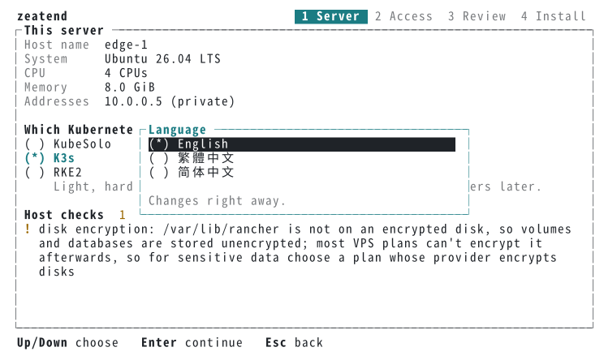
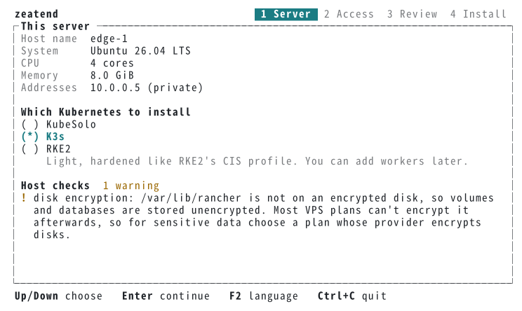
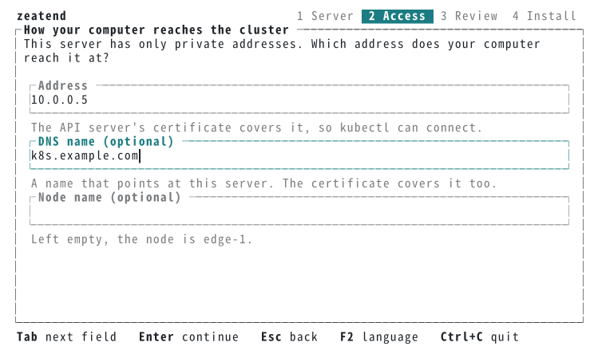
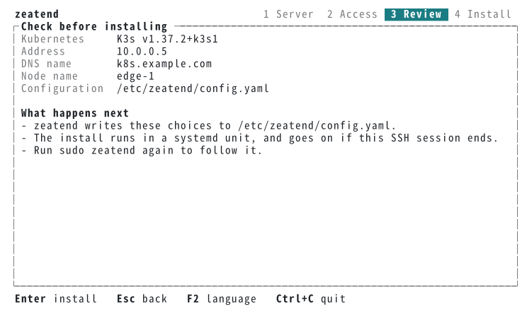
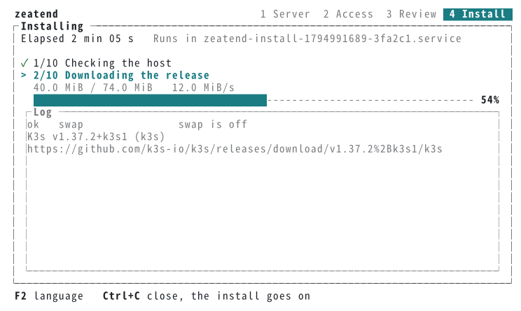
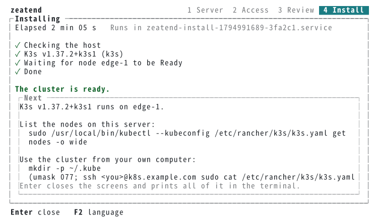

When you finish this page, a Linux server runs a Kubernetes cluster that Zeatend set up, and `zeatend doctor` reports it healthy. The last step links to the Zeabur OSS install.

To install Zeabur OSS on a new server in one go, follow [Install with Zeatend](https://oss.zeabur.com/docs/zeabur/install/one-command/). That page runs the steps of this one for K3s. This page covers every distribution and explains each step.

This page installs on Zeatend's install screens. To install from a script, or to run each step yourself, see [Install with commands](install-with-commands.mdx).

## Let an agent do it

Paste this prompt into Claude Code or Codex on a computer that can reach the server over SSH, and tell it the server's address:

```text
Set up Kubernetes on my server with Zeatend by following https://oss.zeabur.com/docs/zeatend/get-started/install-with-commands.md.
```

The agent shows you the plan and the host checks and asks before it installs.

The agent can't use the install screens, so it follows [Install with commands](install-with-commands.mdx).

## Before you begin

- **A Linux server that boots with systemd**, on x86-64 or ARM64, with root access through `sudo`. See [Supported servers](../reference/hosts.mdx) for memory, disk and ports.
- **Access to GitHub** from the server. Zeatend and the distributions download from GitHub. For KubeSolo, Zeatend also downloads `kubectl` from `dl.k8s.io`.
- **A choice of distribution:**

  | Distribution | Use it for | Memory |
  | --- | --- | --- |
  | K3s (the default) | One server, and workers that you add later | 1900 MiB or more |
  | RKE2 | Three or more servers, so the cluster keeps running when one goes down | More than K3s; `zeatend plan` warns when it is too low |
  | KubeSolo | One small server that never takes another node | 1400 MiB or more |

<Steps>
<Step>
### Download Zeatend

Run these commands on the server. The first line gets the latest version from [GitHub Releases](https://github.com/zeabur-oss/zeatend/releases). To install a given version, replace it with `version=v0.2.0` or the version you want.

```sh
version=$(basename "$(curl -fsSLo /dev/null -w '%{url_effective}' https://github.com/zeabur-oss/zeatend/releases/latest)")
arch=$(uname -m | sed 's/x86_64/amd64/; s/aarch64/arm64/')
curl -fsSLO "https://github.com/zeabur-oss/zeatend/releases/download/$version/zeatend-$version-linux-$arch.tar.gz" &&
  curl -fsSLO "https://github.com/zeabur-oss/zeatend/releases/download/$version/SHA256SUMS" &&
  sha256sum --ignore-missing -c SHA256SUMS &&
  tar -xzf "zeatend-$version-linux-$arch.tar.gz" zeatend &&
  sudo install -m 0755 zeatend /usr/local/bin/zeatend &&
  zeatend --version
```

`sha256sum` prints `OK` when the download matches the release. `zeatend` is one static file and needs no other packages.
</Step>
<Step>
### Open the install screens

```sh
sudo zeatend
```

The top line shows the four steps: 1 Server, 2 Access, 3 Review, 4 Install. The bottom line shows the keys you can press now:

| Key | What it does |
| --- | --- |
| Up and Down | Choose a distribution |
| Tab | Go to the next field |
| Enter | Continue. On Review, start the install |
| Esc | Go back one step |
| F2 | Change the language: English, 繁體中文 or 简体中文. The screens change at once |
| Ctrl+C | Quit. After the install starts, it only closes the screens and the install goes on |


</Step>
<Step>
### Choose a distribution

The first screen is **Server**. Its top half shows this server's host name, system, CPUs, memory and addresses.

Under **Which Kubernetes to install**, choose K3s, RKE2 or KubeSolo with the arrow keys. Each choice says when it fits. If you aren't sure, choose K3s.

**Host checks** lists the result of each check. A check that needs attention says what to do and does not stop the install. If a check fails, Enter does not continue: fix what that line names, then run `sudo zeatend` again.

Press Enter to continue.


</Step>
<Step>
### Enter the address

The **Access** screen asks which address your computer uses to reach this server. kubectl on your computer connects to this address later.

- **Address**: when the server has a public IP address, it is filled in. Change it if your computer uses another one. When the server has only private addresses, enter the IP address your computer reaches it at. The API server's certificate covers this address.
- **DNS name**: optional. Enter it to reach the API server by a domain name. The certificate covers it too.
- **Node name**: optional. Left empty, the node takes the host name.

Press Tab to go to the next field and Enter to continue. A field that isn't in the right form says what it expects.


</Step>
<Step>
### Review and start the install

The **Review** screen lists the Kubernetes version, the address, the DNS name, the node name, the configuration file and what happens next. To change something, press Esc.

Press Enter to start the install. Zeatend writes your choices to `/etc/zeatend/config.yaml`. If the file is already there, it changes only these settings and keeps the others.


</Step>
<Step>
### Wait for the install

The **Install** screen shows the current step, the time so far and the log. The install takes a few minutes.



The install runs in the systemd unit `zeatend-install-<id>.service`. Ctrl+C only closes the screens, and so does a dropped SSH session: the install goes on. Run `sudo zeatend` again to watch it.

When it is done, the screen says "The cluster is ready." **Next** lists the commands to list the nodes and to use the cluster from your own computer. Press Enter to close the screens; the terminal then prints the whole text, so you can copy it.



The kubeconfig in those commands makes whoever has it a cluster admin. Keep it only on the server or your own computer.

If the screen says "The install stopped.", the last lines of the log give the cause. For the whole output, run `journalctl -u 'zeatend-install-*'`. Fix the cause, then run `sudo zeatend` again.
</Step>
<Step>
### Check the cluster

```sh
sudo zeatend doctor
```

`doctor` runs the host checks again, then checks the service, the API server, the install record, the nodes, the memory the kubelet keeps for the system and, on K3s and RKE2, that Secrets are stored encrypted. Each line that isn't `ok` names the command to run. It exits 0 when every check passes, 1 when one warns and 2 when one fails.
</Step>
<Step>
### Install Zeabur OSS

On K3s, follow [Install with Zeatend](https://oss.zeabur.com/docs/zeabur/install/one-command/) from **Let the cluster trust sign-in**. That step adds `apiServer.authenticationConfig` to `/etc/zeatend/config.yaml`, so the API server accepts sign-ins from Zeabur Identity, and runs `zeatend apply` again. Then one `helm install` installs Zeabur OSS.

On RKE2 or KubeSolo, follow [Install Zeabur OSS in an existing cluster](https://oss.zeabur.com/docs/zeabur/install/existing-cluster/).
</Step>
</Steps>

## Next

- [Add nodes](../operations/add-nodes.mdx) to run services on more servers.
- [Maintain the cluster](../operations/maintain.mdx): upgrades, certificates and backups.
