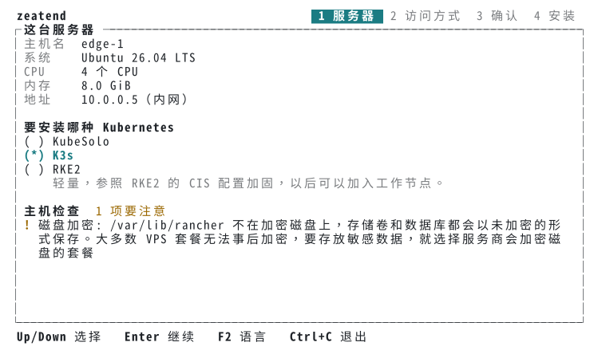
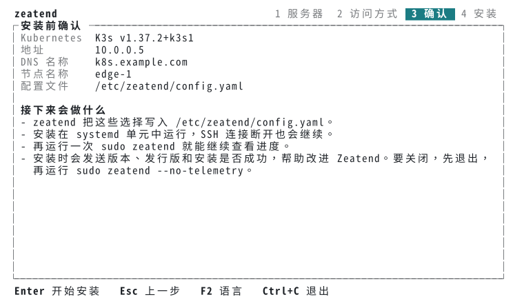

照这一页做完，Linux 服务器上会运行 Zeatend 创建的 Kubernetes 集群，`zeatend doctor` 会报告集群运行正常。最后一步会链接到 Zeabur 开源版的安装文档。

要在新服务器上一次装好 Zeabur 开源版，见[用 Zeatend 安装](https://oss.zeabur.com/zh-CN/docs/zeabur/install/one-command/)。该文档用 K3s 完成本页的步骤。本页涵盖所有发行版，并解释每一步。

大多数人用 Zeatend 的安装界面安装。也可以交给 Agent，或按[用命令安装](#用命令安装)逐步运行命令。

## 交给 Agent 安装

在能通过 SSH 连接服务器的电脑上，将这段提示词粘贴到 Claude Code 或 Codex，并告诉 Agent 服务器的地址：

```text
请按照 https://oss.zeabur.com/docs/zeatend/get-started/install.md 在我的服务器上用 Zeatend 安装 Kubernetes。
```

Agent 会显示安装计划和主机检查结果，征得你的同意后再安装。

Agent 无法操作安装界面，会改用[用命令安装](#用命令安装)的步骤。

## 开始前

- **一台用 systemd 启动的 Linux 服务器**，架构为 x86-64 或 ARM64，能通过 `sudo` 获取 root 权限。内存、磁盘和端口要求见[支持的服务器](../reference/hosts.mdx)。
- **服务器能访问 GitHub**。Zeatend 和各发行版都从 GitHub 下载。使用 KubeSolo 时，Zeatend 还会从 `dl.k8s.io` 下载 `kubectl`。
- **选好发行版：**

  | 发行版 | 适用场景 | 内存 |
  | --- | --- | --- |
  | K3s（默认） | 一台服务器，之后可添加工作节点 | 至少 1900 MiB |
  | RKE2 | 三台或更多服务器，一台停机后集群仍能运行 | 比 K3s 更多；内存不足时，`zeatend plan` 会警告 |
  | KubeSolo | 一台小型服务器，不会添加其他节点 | 至少 1400 MiB |

<Steps>
<Step>
### 下载 Zeatend

在服务器上运行这些命令。第一行从 [GitHub Releases](https://github.com/zeabur-oss/zeatend/releases) 获取最新版本。要安装指定版本，将第一行换成 `version=v0.2.0` 或你需要的版本。

```sh
version=$(basename "$(curl -fsSLo /dev/null -w '%{url_effective}' https://github.com/zeabur-oss/zeatend/releases/latest)")
arch=$(uname -m | sed 's/x86_64/amd64/; s/aarch64/arm64/')
curl -fsSLO "https://github.com/zeabur-oss/zeatend/releases/download/$version/zeatend-$version-linux-$arch.tar.gz" &&
  curl -fsSLO "https://github.com/zeabur-oss/zeatend/releases/download/$version/SHA256SUMS" &&
  sha256sum --ignore-missing -c SHA256SUMS &&
  tar -xzf "zeatend-$version-linux-$arch.tar.gz" zeatend &&
  sudo install -m 0755 zeatend /usr/local/bin/zeatend &&
  zeatend --version
```

下载的文件与发行文件一致时，`sha256sum` 会输出 `OK`。`zeatend` 是一个静态二进制文件，不需要其他软件包。
</Step>
<Step>
### 在安装界面安装

```sh
sudo zeatend
```

安装界面分为四步。按 F2 可以在英语、繁体中文和简体中文之间切换。

1. **服务器**：列出主机信息和主机检查。用上下键选择 K3s、RKE2 或 KubeSolo，再按 Enter。需要注意的检查项都会写出处理方法。

   

2. **访问方式**：填写你的电脑连接这台服务器所用的地址。要用 DNS 名称连接 API 服务器，也一起填上。节点名称可以不填。按 Tab 切换到下一项。
3. **确认**：列出版本、地址和配置文件。按 Enter 后，Zeatend 会把你的选择写入 `/etc/zeatend/config.yaml`，开始安装。

   

4. **安装**：显示进度，大约需要几分钟。安装在 systemd 单元中运行，按 Ctrl+C 关闭界面或 SSH 断开都会继续；再运行一次 `sudo zeatend` 就能继续查看。完成后，界面会列出查看节点、从自己的电脑使用集群的命令。

   

这些命令里的 kubeconfig 是集群管理员的凭据，只能放在服务器或你自己的电脑上。
</Step>
<Step>
### 检查集群

```sh
sudo zeatend doctor
```

`doctor` 会再次运行主机检查，再检查服务、API 服务器、安装记录、节点、kubelet 为系统预留的内存；使用 K3s 和 RKE2 时，还会检查机密变量是否加密存储。每行非 `ok` 的结果都会给出要运行的命令。所有检查通过时，退出码为 0；有警告时为 1；有失败时为 2。
</Step>
<Step>
### 安装 Zeabur 开源版

使用 K3s 时，打开 Zeabur 开源版的[用 Zeatend 安装](https://oss.zeabur.com/zh-CN/docs/zeabur/install/one-command/)，从**用 Zeatend 装好 Kubernetes** 这一步继续。该步骤会向 `/etc/zeatend/config.yaml` 添加 `apiServer.authenticationConfig`，让 API 服务器接受 Zeabur Identity 的登录，再次运行 `zeatend apply`，然后用一条 `helm install` 安装 Zeabur 开源版。

使用 RKE2 或 KubeSolo 时，见[将 Zeabur 开源版安装到已有集群](https://oss.zeabur.com/zh-CN/docs/zeabur/install/existing-cluster/)。
</Step>
</Steps>

## 用命令安装

要写成脚本、交给 Agent，或想自己运行每一步时，可以不用安装界面，改用命令。先下载 Zeatend，再依次完成下面三步，完成后回到[检查集群](#检查集群)。

<Steps>
<Step>
### 编写配置

Zeatend 读取 `/etc/zeatend/config.yaml`。文件不存在时，会按默认配置安装 K3s，因此使用 K3s 可以跳过这一步。

使用 RKE2 或 KubeSolo 时，写入配置文件：

```sh
sudo mkdir -p /etc/zeatend
echo 'distribution: rke2' | sudo tee /etc/zeatend/config.yaml
```

使用 KubeSolo 时，将 `rke2` 换成 `kubesolo`。要同时用 DNS 名称访问 API 服务器，将名称添加到 `host.tlsSan`。[配置文件](../reference/configuration.mdx)列出了所有设置。
</Step>
<Step>
### 检查安装计划

```sh
sudo zeatend plan
```

`plan` 不做任何修改，会输出要安装的版本、节点名称和地址、要写入的文件，以及主机检查结果：

```text
==> Checking the host
    ok   root               running as root
    ok   systemd            systemd is the init system
    warn swap               swap is on; the kubelet expects it off (swapoff -a, and remove it from /etc/fstab)
    ok   ports              80, 443, 6443 and 10250 are free
    ok   disk space         95.0 GiB free under /var/lib
```

出现 `FAIL` 时，安装会停止。解决该行指出的问题，再运行 `plan`。`warn` 不会阻止安装，每行警告都会给出修复命令。
</Step>
<Step>
### 安装集群

```sh
sudo zeatend apply
```

`apply` 会下载发行版，用 Zeatend 内置的摘要验证每个文件，写入配置、启动服务，并等待节点进入 `Ready` 状态，大约需要几分钟。

安装在 `zeatend-install-<id>.service` 这个 systemd 单元中运行，SSH 会话断开后仍会继续。再次运行 `sudo zeatend apply` 就能接着查看进度，完整输出见 `journalctl -u 'zeatend-install-*'`。

结束时会输出版本、节点和后续操作命令：

```text
==> Waiting for node vps-1 to be Ready
K3s v1.37.2+k3s1 runs on vps-1.

List the nodes on this server:
  sudo /var/lib/rancher/k3s/data/current/bin/kubectl --kubeconfig /etc/rancher/k3s/k3s.yaml get nodes -o wide

Use the cluster from your own computer:
  mkdir -p ~/.kube
  (umask 077; ssh <you>@203.0.113.10 sudo cat /etc/rancher/k3s/k3s.yaml > ~/.kube/vps-1.yaml)
  sed -i.bak 's#https://127.0.0.1:6443#https://203.0.113.10:6443#' ~/.kube/vps-1.yaml
  KUBECONFIG=~/.kube/vps-1.yaml kubectl get nodes

Whoever has this file is cluster admin; keep it like an SSH key.
==> Done
```

输出中提到的 kubeconfig 是集群的管理员凭证，只保存在服务器或你自己的电脑上。`apply` 可以安全地重复运行，让服务器与配置保持一致。
</Step>
</Steps>

## 接下来

- [添加节点](../operations/add-nodes.mdx)，在更多服务器上运行服务。
- [维护集群](../operations/maintain.mdx)：升级、证书和备份。
