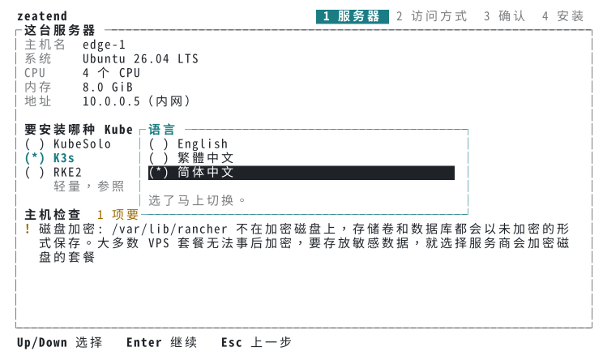
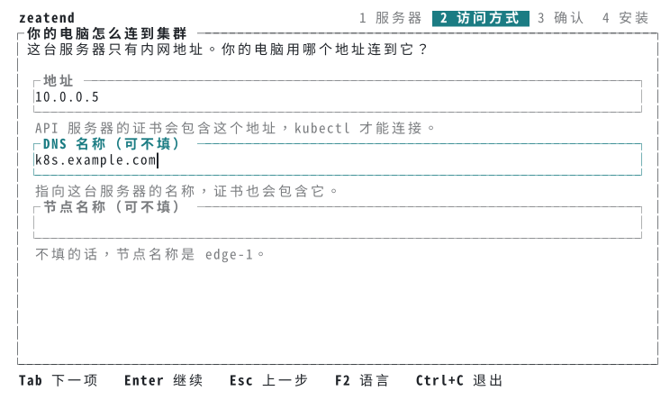
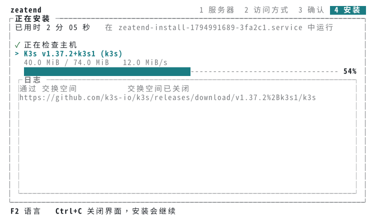
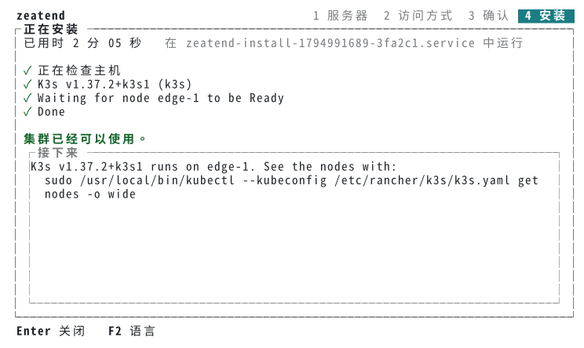

照这一页做完，Linux 服务器上会运行 Zeatend 创建的 Kubernetes 集群，`zeatend doctor` 会报告集群运行正常。最后一步会链接到 Zeabur 开源版的安装文档。

要在新服务器上一次装好 Zeabur 开源版，见[用 Zeatend 安装](https://oss.zeabur.com/zh-CN/docs/zeabur/install/one-command/)。该文档用 K3s 完成本页的步骤。本页涵盖所有发行版，并解释每一步。

本页用 Zeatend 的安装界面安装。要写成脚本，或想自己运行每一步，见[用命令安装](install-with-commands.mdx)。

## 交给 Agent 安装

在能通过 SSH 连接服务器的电脑上，将这段提示词粘贴到 Claude Code 或 Codex，并告诉 Agent 服务器的地址：

```text
请按照 https://oss.zeabur.com/docs/zeatend/get-started/install-with-commands.md 在我的服务器上用 Zeatend 安装 Kubernetes。
```

Agent 会显示安装计划和主机检查结果，征得你的同意后再安装。

Agent 无法操作安装界面，会按[用命令安装](install-with-commands.mdx)的步骤运行。

## 开始前

- **一台用 systemd 启动的 Linux 服务器**，架构为 x86-64 或 ARM64，能通过 `sudo` 获取 root 权限。内存、磁盘和端口要求见[支持的服务器](../reference/hosts.mdx)。
- **服务器能访问 GitHub**。Zeatend 和各发行版都从 GitHub 下载。使用 KubeSolo 时，Zeatend 还会从 `dl.k8s.io` 下载 `kubectl`。
- **选好发行版：**

  | 发行版 | 适用场景 | 内存 |
  | --- | --- | --- |
  | K3s（默认） | 一台服务器，之后可添加工作节点 | 至少 1900 MiB |
  | RKE2 | 三台或更多服务器，一台停机后集群仍能运行 | 比 K3s 更多；内存不足时，`zeatend plan` 会警告 |
  | KubeSolo | 一台小型服务器，不会添加其他节点 | 至少 1400 MiB |

<Steps>
<Step>
### 下载 Zeatend

在服务器上运行这些命令。第一行从 [GitHub Releases](https://github.com/zeabur-oss/zeatend/releases) 获取最新版本。要安装指定版本，将第一行换成 `version=v0.2.0` 或你需要的版本。

```sh
version=$(basename "$(curl -fsSLo /dev/null -w '%{url_effective}' https://github.com/zeabur-oss/zeatend/releases/latest)")
arch=$(uname -m | sed 's/x86_64/amd64/; s/aarch64/arm64/')
curl -fsSLO "https://github.com/zeabur-oss/zeatend/releases/download/$version/zeatend-$version-linux-$arch.tar.gz" &&
  curl -fsSLO "https://github.com/zeabur-oss/zeatend/releases/download/$version/SHA256SUMS" &&
  sha256sum --ignore-missing -c SHA256SUMS &&
  tar -xzf "zeatend-$version-linux-$arch.tar.gz" zeatend &&
  sudo install -m 0755 zeatend /usr/local/bin/zeatend &&
  zeatend --version
```

下载的文件与发行文件一致时，`sha256sum` 会输出 `OK`。`zeatend` 是一个静态二进制文件，不需要其他软件包。
</Step>
<Step>
### 打开安装界面

```sh
sudo zeatend
```

界面最上方是接下来的四步：1 服务器、2 访问方式、3 确认、4 安装。最下面一行是现在可以按的键：

| 按键 | 作用 |
| --- | --- |
| 上、下 | 选择发行版 |
| Tab | 切换到下一项 |
| Enter | 继续。在确认界面按下即开始安装 |
| Esc | 返回上一步 |
| F2 | 切换语言：English、繁體中文或简体中文，选了马上切换 |
| Ctrl+C | 退出。开始安装后只会关闭界面，安装会继续 |


</Step>
<Step>
### 选择发行版

第一个界面是**服务器**。上半部分是这台服务器的主机名、系统、CPU、内存和地址。

在**要安装哪种 Kubernetes** 中用上下键选择 K3s、RKE2 或 KubeSolo，每个选项都写明适用情况。不确定就选 K3s。

**主机检查**列出每项检查的结果。需要注意的项目会写出处理方法，不会阻止安装。有项目失败时，按 Enter 不会继续：按该行的说明修复，再运行一次 `sudo zeatend`。

按 Enter 继续。


</Step>
<Step>
### 填写地址

**访问方式**界面询问你的电脑用哪个地址连接这台服务器。之后在自己的电脑上用 kubectl，就是连接这个地址。

- **地址**：服务器有公网 IP 时会预先填好，你的电脑用其他地址时再修改。服务器只有内网地址时，填写你的电脑连接它所用的 IP。API 服务器的证书会包含这个地址。
- **DNS 名称**：可以不填。要用域名连接 API 服务器时填写，证书也会包含它。
- **节点名称**：可以不填，不填就使用主机名。

按 Tab 切换项，按 Enter 继续。格式不对时，该项下方会说明应该怎么填。


</Step>
<Step>
### 确认并开始安装

**确认**界面列出要安装的 Kubernetes 版本、地址、DNS 名称、节点名称、配置文件，以及接下来会做什么。要修改就按 Esc 返回上一步。

按 Enter 开始安装。Zeatend 会把你的选择写入 `/etc/zeatend/config.yaml`；文件已经存在时，只改这几项，其他配置不变。


</Step>
<Step>
### 等待安装完成

**安装**界面显示当前步骤、已用时间和日志，大约需要几分钟。



安装在 systemd 单元 `zeatend-install-<id>.service` 中运行。按 Ctrl+C 只会关闭界面，SSH 断开也一样，安装都会继续。再运行一次 `sudo zeatend` 就能继续查看进度。

完成时界面会显示“集群已经可以使用。”，**接下来**列出查看节点、从自己的电脑使用集群的命令。按 Enter 关闭界面后，终端会打印完整内容，方便复制。



这些命令里的 kubeconfig 是集群管理员的凭据，只能放在服务器或你自己的电脑上。

界面显示“安装停止了。”时，日志的最后几行会写明原因。完整输出可以用 `journalctl -u 'zeatend-install-*'` 查看。修复后再运行一次 `sudo zeatend`。
</Step>
<Step>
### 检查集群

```sh
sudo zeatend doctor
```

`doctor` 会再次运行主机检查，再检查服务、API 服务器、安装记录、节点、kubelet 为系统预留的内存；使用 K3s 和 RKE2 时，还会检查机密变量是否加密存储。每行非 `ok` 的结果都会给出要运行的命令。所有检查通过时，退出码为 0；有警告时为 1；有失败时为 2。
</Step>
<Step>
### 安装 Zeabur 开源版

使用 K3s 时，打开 Zeabur 开源版的[用 Zeatend 安装](https://oss.zeabur.com/zh-CN/docs/zeabur/install/one-command/)，从**让集群信任登录**这一步继续。该步骤会向 `/etc/zeatend/config.yaml` 添加 `apiServer.authenticationConfig`，让 API 服务器接受 Zeabur Identity 的登录，再次运行 `zeatend apply`，然后用一条 `helm install` 安装 Zeabur 开源版。

使用 RKE2 或 KubeSolo 时，见[将 Zeabur 开源版安装到已有集群](https://oss.zeabur.com/zh-CN/docs/zeabur/install/existing-cluster/)。
</Step>
</Steps>

## 接下来

- [添加节点](../operations/add-nodes.mdx)，在更多服务器上运行服务。
- [维护集群](../operations/maintain.mdx)：升级、证书和备份。
