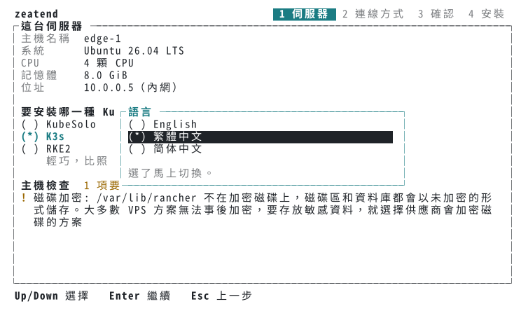
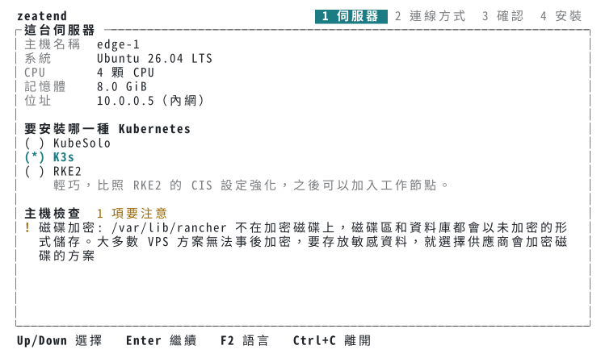
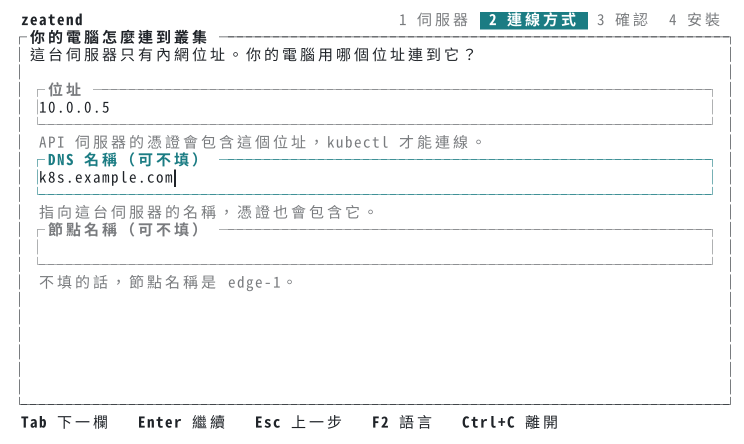
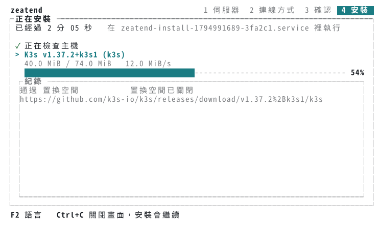

照這一頁做完，Linux 伺服器上就會有 Zeatend 建立的 Kubernetes 叢集，`zeatend doctor` 也會回報叢集運作正常。最後一步會連到 Zeabur 開源版的安裝文件。

想在新伺服器上一次裝好 Zeabur 開源版，請照[用 Zeatend 安裝](https://oss.zeabur.com/zh-TW/docs/zeabur/install/one-command/)操作。那份文件會用 K3s 完成本頁的步驟；本頁則涵蓋所有發行版，並說明每個步驟。

這一頁用 Zeatend 的安裝畫面安裝。要寫成腳本，或想自己執行每一步，見[用指令安裝](install-with-commands.mdx)。

## 交給 Agent 安裝

在能用 SSH 連上伺服器的電腦上，把這段提示貼到 Claude Code 或 Codex，並提供伺服器位址：

```text
請依照 https://oss.zeabur.com/docs/zeatend/get-started/install-with-commands.md 在我的伺服器上用 Zeatend 安裝 Kubernetes。
```

Agent 會顯示安裝計畫與主機檢查結果，等你確認後才安裝。

Agent 不能操作安裝畫面，會照[用指令安裝](install-with-commands.mdx)的步驟執行。

## 開始之前

- **一台用 systemd 啟動的 Linux 伺服器**，架構為 x86-64 或 ARM64，並能用 `sudo` 取得 root 權限。記憶體、磁碟與連接埠需求見[支援的伺服器](../reference/hosts.mdx)。
- **伺服器能連上 GitHub**。Zeatend 與各發行版都從 GitHub 下載。使用 KubeSolo 時，Zeatend 還會從 `dl.k8s.io` 下載 `kubectl`。
- **選好發行版**：

  | 發行版 | 適用情況 | 記憶體 |
  | --- | --- | --- |
  | K3s（預設） | 一台伺服器，之後可新增工作節點 | 至少 1900 MiB |
  | RKE2 | 三台以上伺服器，一台故障時叢集仍能繼續執行 | 比 K3s 多；不足時 `zeatend plan` 會提出警告 |
  | KubeSolo | 一台小型伺服器，之後不會加入其他節點 | 至少 1400 MiB |

<Steps>
<Step>
### 下載 Zeatend

在伺服器上執行這些指令。第一行會從 [GitHub Releases](https://github.com/zeabur-oss/zeatend/releases) 取得最新版本。要安裝指定版本，把第一行換成 `version=v0.2.0` 或你要的版本。

```sh
version=$(basename "$(curl -fsSLo /dev/null -w '%{url_effective}' https://github.com/zeabur-oss/zeatend/releases/latest)")
arch=$(uname -m | sed 's/x86_64/amd64/; s/aarch64/arm64/')
curl -fsSLO "https://github.com/zeabur-oss/zeatend/releases/download/$version/zeatend-$version-linux-$arch.tar.gz" &&
  curl -fsSLO "https://github.com/zeabur-oss/zeatend/releases/download/$version/SHA256SUMS" &&
  sha256sum --ignore-missing -c SHA256SUMS &&
  tar -xzf "zeatend-$version-linux-$arch.tar.gz" zeatend &&
  sudo install -m 0755 zeatend /usr/local/bin/zeatend &&
  zeatend --version
```

下載內容與發行檔相符時，`sha256sum` 會印出 `OK`。`zeatend` 是單一靜態執行檔，不需要其他套件。
</Step>
<Step>
### 開啟安裝畫面

```sh
sudo zeatend
```

畫面最上面是接下來的四步：1 伺服器、2 連線方式、3 確認、4 安裝。最下面一列是現在能按的鍵：

| 按鍵 | 作用 |
| --- | --- |
| 上、下 | 選擇發行版 |
| Tab | 換到下一欄 |
| Enter | 繼續。在確認畫面按下就開始安裝 |
| Esc | 回上一步 |
| F2 | 切換語言：English、繁體中文或简体中文，選了馬上切換 |
| Ctrl+C | 離開。開始安裝後只會關掉畫面，安裝會繼續 |


</Step>
<Step>
### 選擇發行版

第一個畫面是**伺服器**。上半部是這台伺服器的主機名稱、系統、CPU、記憶體和位址。

在**要安裝哪一種 Kubernetes** 用上下鍵選 K3s、RKE2 或 KubeSolo，每個選項都寫著適合什麼情況。不確定就選 K3s。

**主機檢查**列出每一項檢查的結果。要注意的項目會寫出怎麼處理，不會擋住安裝。有項目失敗時，按 Enter 不會繼續：照那一行的說明修好，再執行一次 `sudo zeatend`。

按 Enter 繼續。


</Step>
<Step>
### 填寫位址

**連線方式**畫面問你的電腦用哪個位址連到這台伺服器。之後在自己的電腦上用 kubectl，就是連到這個位址。

- **位址**：伺服器有公開 IP 時會先填好，你的電腦用別的位址再修改。伺服器只有內網位址時，填你的電腦連到它用的 IP。API 伺服器的憑證會包含這個位址。
- **DNS 名稱**：可以不填。要用網域名稱連到 API 伺服器時填上，憑證也會包含它。
- **節點名稱**：可以不填，不填就用主機名稱。

按 Tab 換欄，按 Enter 繼續。格式不對時，欄位下方會寫出該怎麼填。


</Step>
<Step>
### 確認並開始安裝

**確認**畫面列出要安裝的 Kubernetes 版本、位址、DNS 名稱、節點名稱、設定檔，以及接下來會做什麼。要修改就按 Esc 回上一步。

按 Enter 開始安裝。Zeatend 會把你的選擇寫進 `/etc/zeatend/config.yaml`；檔案已經存在時，只改這幾項，其他設定不變。


</Step>
<Step>
### 等安裝完成

**安裝**畫面顯示目前的步驟、經過的時間和紀錄，約需幾分鐘。



安裝在 systemd 單元 `zeatend-install-<id>.service` 裡執行。按 Ctrl+C 只會關掉畫面，SSH 斷線也一樣，安裝都會繼續。再執行一次 `sudo zeatend` 就能接著看進度。

完成時畫面會顯示「叢集已經可以使用。」，**接下來**列出查看節點、從自己的電腦使用叢集的指令。按 Enter 關閉畫面後，終端機會印出完整內容，方便複製。


這些指令裡的 kubeconfig 是叢集管理員的認證資訊，只能放在伺服器或你自己的電腦上。

畫面顯示「安裝停止了。」時，紀錄的最後幾行會寫出原因。完整輸出可以用 `journalctl -u 'zeatend-install-*'` 查看。修好後再執行一次 `sudo zeatend`。
</Step>
<Step>
### 檢查叢集

```sh
sudo zeatend doctor
```

`doctor` 會再次檢查主機，再檢查服務、API 伺服器、安裝紀錄、節點，以及 kubelet 為系統保留的記憶體。K3s 和 RKE2 還會檢查機密變數是否加密儲存。每個非 `ok` 的項目都會列出要執行的指令。全部通過時結束碼為 0，有警告時為 1，有失敗時為 2。
</Step>
<Step>
### 安裝 Zeabur 開源版

使用 K3s 時，從 Zeabur 開源版的[用 Zeatend 安裝](https://oss.zeabur.com/zh-TW/docs/zeabur/install/one-command/)裡的**讓叢集信任登入**開始操作。這一步會在 `/etc/zeatend/config.yaml` 加上 `apiServer.authenticationConfig`，讓 API 伺服器接受 Zeabur Identity 的登入，再執行一次 `zeatend apply`。接著用一個 `helm install` 就能安裝 Zeabur 開源版。

使用 RKE2 或 KubeSolo 時，請照[把 Zeabur 開源版裝進既有叢集](https://oss.zeabur.com/zh-TW/docs/zeabur/install/existing-cluster/)操作。
</Step>
</Steps>

## 接下來

- [新增節點](../operations/add-nodes.mdx)，讓服務在更多伺服器上執行。
- [維護叢集](../operations/maintain.mdx)：升級、憑證與備份。
