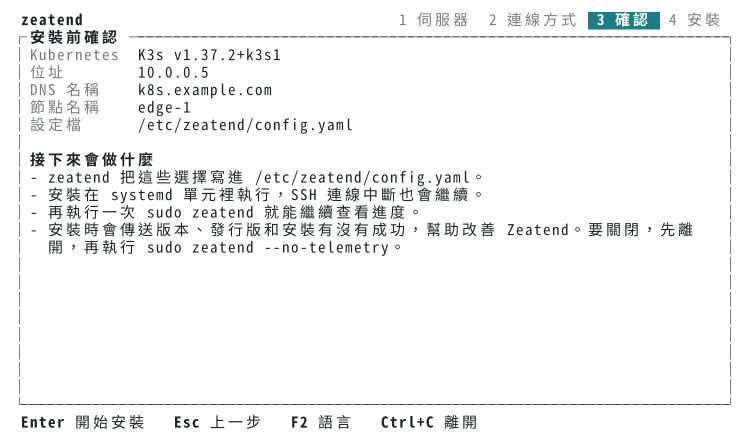
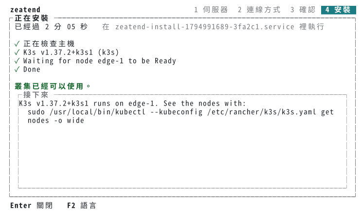

照這一頁做完，Linux 伺服器上就會有 Zeatend 建立的 Kubernetes 叢集，`zeatend doctor` 也會回報叢集運作正常。最後一步會連到 Zeabur 開源版的安裝文件。

想在新伺服器上一次裝好 Zeabur 開源版，請照[用 Zeatend 安裝](https://oss.zeabur.com/zh-TW/docs/zeabur/install/one-command/)操作。那份文件會用 K3s 完成本頁的步驟；本頁則涵蓋所有發行版，並說明每個步驟。

大多數人用 Zeatend 的安裝畫面安裝。也可以交給 Agent，或照[用指令安裝](#用指令安裝)一步步執行指令。

## 交給 Agent 安裝

在能用 SSH 連上伺服器的電腦上，把這段提示貼到 Claude Code 或 Codex，並提供伺服器位址：

```text
請依照 https://oss.zeabur.com/docs/zeatend/get-started/install.md 在我的伺服器上用 Zeatend 安裝 Kubernetes。
```

Agent 會顯示安裝計畫與主機檢查結果，等你確認後才安裝。

Agent 不能操作安裝畫面，會改用[用指令安裝](#用指令安裝)的步驟。

## 開始之前

- **一台用 systemd 啟動的 Linux 伺服器**，架構為 x86-64 或 ARM64，並能用 `sudo` 取得 root 權限。記憶體、磁碟與連接埠需求見[支援的伺服器](../reference/hosts.mdx)。
- **伺服器能連上 GitHub**。Zeatend 與各發行版都從 GitHub 下載。使用 KubeSolo 時，Zeatend 還會從 `dl.k8s.io` 下載 `kubectl`。
- **選好發行版**：

  | 發行版 | 適用情況 | 記憶體 |
  | --- | --- | --- |
  | K3s（預設） | 一台伺服器，之後可新增工作節點 | 至少 1900 MiB |
  | RKE2 | 三台以上伺服器，一台故障時叢集仍能繼續執行 | 比 K3s 多；不足時 `zeatend plan` 會提出警告 |
  | KubeSolo | 一台小型伺服器，之後不會加入其他節點 | 至少 1400 MiB |

<Steps>
<Step>
### 下載 Zeatend

在伺服器上執行這些指令。第一行會從 [GitHub Releases](https://github.com/zeabur-oss/zeatend/releases) 取得最新版本。要安裝指定版本，把第一行換成 `version=v0.2.0` 或你要的版本。

```sh
version=$(basename "$(curl -fsSLo /dev/null -w '%{url_effective}' https://github.com/zeabur-oss/zeatend/releases/latest)")
arch=$(uname -m | sed 's/x86_64/amd64/; s/aarch64/arm64/')
curl -fsSLO "https://github.com/zeabur-oss/zeatend/releases/download/$version/zeatend-$version-linux-$arch.tar.gz" &&
  curl -fsSLO "https://github.com/zeabur-oss/zeatend/releases/download/$version/SHA256SUMS" &&
  sha256sum --ignore-missing -c SHA256SUMS &&
  tar -xzf "zeatend-$version-linux-$arch.tar.gz" zeatend &&
  sudo install -m 0755 zeatend /usr/local/bin/zeatend &&
  zeatend --version
```

下載內容與發行檔相符時，`sha256sum` 會印出 `OK`。`zeatend` 是單一靜態執行檔，不需要其他套件。
</Step>
<Step>
### 在安裝畫面安裝

```sh
sudo zeatend
```

安裝畫面分成四步。按 F2 可以在英文、繁體中文和簡體中文之間切換。

1. **伺服器**：列出主機資訊和主機檢查。用上下鍵選 K3s、RKE2 或 KubeSolo，再按 Enter。要注意的檢查項目都會寫出怎麼處理。

   

2. **連線方式**：填你的電腦連到這台伺服器用的位址。要用 DNS 名稱連 API 伺服器，也一起填上。節點名稱可以不填。按 Tab 換到下一欄。
3. **確認**：列出版本、位址和設定檔。按 Enter 後，Zeatend 會把你的選擇寫進 `/etc/zeatend/config.yaml`，開始安裝。

   

4. **安裝**：顯示進度，約需幾分鐘。安裝在 systemd 單元裡執行，按 Ctrl+C 關掉畫面或 SSH 斷線都會繼續；再執行一次 `sudo zeatend` 就能接著看。完成後，畫面會列出查看節點、從自己的電腦使用叢集的指令。

   

這些指令裡的 kubeconfig 是叢集管理員的認證資訊，只能放在伺服器或你自己的電腦上。
</Step>
<Step>
### 檢查叢集

```sh
sudo zeatend doctor
```

`doctor` 會再次檢查主機，再檢查服務、API 伺服器、安裝紀錄、節點，以及 kubelet 為系統保留的記憶體。K3s 和 RKE2 還會檢查機密變數是否加密儲存。每個非 `ok` 的項目都會列出要執行的指令。全部通過時結束碼為 0，有警告時為 1，有失敗時為 2。
</Step>
<Step>
### 安裝 Zeabur 開源版

使用 K3s 時，從 Zeabur 開源版的[用 Zeatend 安裝](https://oss.zeabur.com/zh-TW/docs/zeabur/install/one-command/)裡的**用 Zeatend 裝好 Kubernetes** 開始操作。這一步會在 `/etc/zeatend/config.yaml` 加上 `apiServer.authenticationConfig`，讓 API 伺服器接受 Zeabur Identity 的登入，再執行一次 `zeatend apply`。接著用一個 `helm install` 就能安裝 Zeabur 開源版。

使用 RKE2 或 KubeSolo 時，請照[把 Zeabur 開源版裝進既有叢集](https://oss.zeabur.com/zh-TW/docs/zeabur/install/existing-cluster/)操作。
</Step>
</Steps>

## 用指令安裝

要寫成腳本、交給 Agent，或想自己執行每一步時，可以不用安裝畫面，改用指令。先下載 Zeatend，再依序做下面三步，完成後回到[檢查叢集](#檢查叢集)。

<Steps>
<Step>
### 寫入設定檔

Zeatend 會讀取 `/etc/zeatend/config.yaml`。沒有這個檔案時，會用預設值安裝 K3s，所以選用 K3s 可以略過這一步。

要用 RKE2 或 KubeSolo，先寫入設定檔：

```sh
sudo mkdir -p /etc/zeatend
echo 'distribution: rke2' | sudo tee /etc/zeatend/config.yaml
```

使用 KubeSolo 時，把 `rke2` 換成 `kubesolo`。如果也要用 DNS 名稱連到 API 伺服器，把名稱加到 `host.tlsSan`。[設定檔](../reference/configuration.mdx)列出所有設定。
</Step>
<Step>
### 檢查安裝計畫

```sh
sudo zeatend plan
```

`plan` 不會修改任何內容，只會印出要安裝的版本、節點名稱與位址、要寫入的檔案，以及主機檢查結果：

```text
==> Checking the host
    ok   root               running as root
    ok   systemd            systemd is the init system
    warn swap               swap is on; the kubelet expects it off (swapoff -a, and remove it from /etc/fstab)
    ok   ports              80, 443, 6443 and 10250 are free
    ok   disk space         95.0 GiB free under /var/lib
```

出現 `FAIL` 就會停止安裝。先解決該行指出的問題，再執行一次 `plan`。`warn` 不會阻止安裝，每一行都會列出解決問題的指令。
</Step>
<Step>
### 安裝叢集

```sh
sudo zeatend apply
```

`apply` 會下載發行版，用 Zeatend 內建的雜湊摘要驗證每個檔案，寫入設定、啟動服務，再等節點進入 `Ready` 狀態，約需幾分鐘。

安裝會在 systemd 單元 `zeatend-install-<id>.service` 中執行，即使 SSH 工作階段斷線也會繼續。再執行一次 `sudo zeatend apply` 就能接著看進度，完整輸出可用 `journalctl -u 'zeatend-install-*'` 檢視。

結束時會印出版本、節點，以及接下來可執行的指令：

```text
==> Waiting for node vps-1 to be Ready
K3s v1.37.2+k3s1 runs on vps-1.

List the nodes on this server:
  sudo /var/lib/rancher/k3s/data/current/bin/kubectl --kubeconfig /etc/rancher/k3s/k3s.yaml get nodes -o wide

Use the cluster from your own computer:
  mkdir -p ~/.kube
  (umask 077; ssh <you>@203.0.113.10 sudo cat /etc/rancher/k3s/k3s.yaml > ~/.kube/vps-1.yaml)
  sed -i.bak 's#https://127.0.0.1:6443#https://203.0.113.10:6443#' ~/.kube/vps-1.yaml
  KUBECONFIG=~/.kube/vps-1.yaml kubectl get nodes

Whoever has this file is cluster admin; keep it like an SSH key.
==> Done
```

輸出列出的 kubeconfig 是叢集管理員的認證資訊，只能放在伺服器或你自己的電腦上。`apply` 可以安全地重複執行，會把伺服器調整成設定檔指定的狀態。
</Step>
</Steps>

## 接下來

- [新增節點](../operations/add-nodes.mdx)，讓服務在更多伺服器上執行。
- [維護叢集](../operations/maintain.mdx)：升級、憑證與備份。
